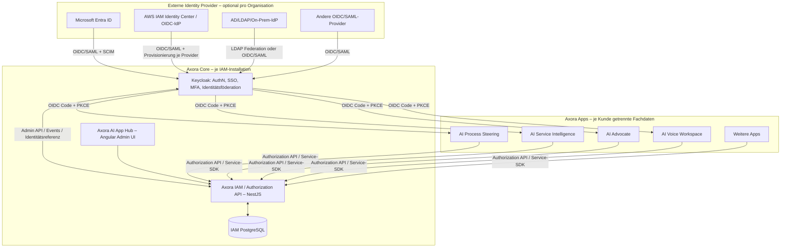
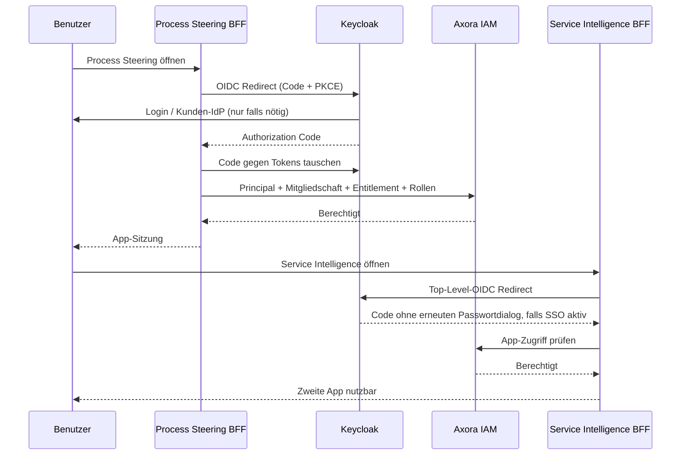
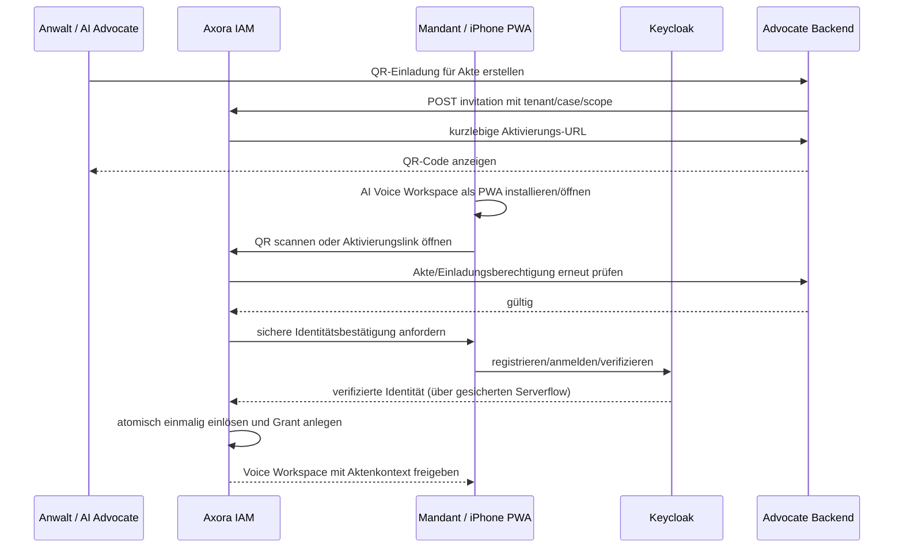

# AXORA IDENTITY & ACCESS MANAGEMENT (IAM)
## Verbindliches Architektur- und Umsetzungskonzept für das Entwicklungsteam

**Version:** 1.0 – Architektur-Baseline / Implementierungsentwurf  
**Stand:** 23.10.2026  
**Auftraggeber / Plattform:** Confessio Management GmbH / Axora  
**Technologieentscheidung:** Keycloak als Identity Engine; Axora IAM als eigenständige Fach- und Integrationsschicht  
**Status:** Zur technischen Umsetzung und ADR-Freigabe; ausdrücklich gekennzeichnete Parameter sind Vorschläge, keine bereits vereinbarten SLA.

---

## 1. Management Summary und bindende Leitentscheidungen

Axora erhält einen zentralen, **cloudneutralen Identitäts-, Benutzer-, Gruppen- und Berechtigungsdienst**. Alle Axora-Apps und Plug&Play-Services verwenden denselben vertraglich definierten Axora-IAM-Zugang. Die zugrunde liegende Authentifizierungs-Engine ist **Keycloak**, selbst betrieben unter Azure, AWS oder On-Premises. Das Administrations-Frontend ist **Axora AI App Hub**.

**Verbindliche Architekturprinzipien:**

1. **Ein logisches Axora-Benutzerkonto je Person und IAM-Installation**, mit mehreren Identitätsverknüpfungen und Organisationen; keine Verknüpfung allein aufgrund gleicher E-Mail-Adresse.
2. **Keycloak authentifiziert; Axora autorisiert.** Keycloak verwaltet Identitätsnachweise, Föderation, SSO, MFA/Passkeys und OIDC-/OAuth-Tokens. Axora IAM verwaltet App-Berechtigungen, Gruppen-Rollen-Zuordnung, Lizenz-/Entitlement-Prüfung, Organisationen und Freigaben auf fachliche Ressourcen.
3. **Eine Schnittstelle für Apps:** Authentisierung ausschließlich über standardisierte OIDC-/OAuth-Flows bzw. Axora-IAM-Guest-Session; fachliche Entscheidung über Axora Authorization API oder identische zentrale Policy-Library. Keine eigene Passwortverwaltung pro App.
4. **Plattformunabhängigkeit:** Azure/AWS/On-Prem sind Installationsziele. Ein Kunde darf auch bei AWS-Betrieb Entra ID, Okta oder On-Prem AD als führendes Verzeichnis haben.
5. **Mandantenschutz ab Datenbankabfrage:** Jede fachliche API erzwingt Organisations-/Tenant- und Ressourcenfilter serverseitig. Tokenrollen oder UI-Ausblendungen ersetzen niemals Datensatzautorisierung.
6. **Least Privilege / Default Deny:** Ohne ausdrückliche Erlaubnis kein Zugriff; hochsensible Operationen verlangen kontextabhängige Prüfungen und ggf. erneute Authentifizierung.
7. **Zero-Trust für QR-Onboarding:** QR-Code ist eine einmalige Einladung, **kein dauerhafter Authentifizierungsnachweis**.
8. **B2C-Gastzugang ist von verifizierter Identität zu unterscheiden:** automatische Anlage einer eingeschränkten Gastidentität und Sitzung; spätere sichere Kontoaufwertung ohne Datenverlust.
9. **Test/Prod getrennt:** Unterschiedliche Issuer, Keycloak-Konfigurationen, Clients, Datenbanken und Schlüssel; keine produktiven Identitäten oder Mandatsdaten ungeprüft in Test.
10. **Alles als Code:** Realm-/Client-/Flow-Konfiguration, Deployment und Policies sind versioniert, reproduzierbar, auditierbar und testbar.

### 1.1 Definition von „Silent Login“

„Silent Login“ bedeutet für Axora: **kein erneutes Eingeben von Zugangsdaten, wenn im jeweiligen Sicherheitskontext eine gültige Sitzung existiert**. Ein kurzer Top-Level-OIDC-Redirect ohne sichtbaren Login-Dialog ist zulässig. Unsichtbare iframe-Logins über Drittanbieter-Cookies werden **nicht** vorausgesetzt. Unterschiedliche Browserprofile, Geräte, private Fenster und iPhone-Homebildschirm-PWAs teilen nicht garantiert dieselbe Sitzung. **100 % Silent Login in jedem Kontext ist technisch keine seriöse Zusage.**

---

## 2. Scope und Begriffe

**Im Scope:** B2B-SSO, Plug&Play-PWAs, Benutzer-/Gruppenadministration, rollen- und ressourcenbezogene Berechtigungen, Kunden-IdP-Anbindung, SCIM/LDAP, Mandanten-/Akteneinladung per QR, B2C-Gastkonto, Service-Identitäten, Audit, Multi-Cloud-Deployment.

**Nicht im Scope der ersten Ausbaustufe:** vollständiges Identity-Governance-System (Rezertifizierungskampagnen), beliebige Policy-Programmiersprache im Browser, plattformübergreifend synchronisierte Offline-Sessions, eigene Entwicklung von Passwort-/MFA-/Passkey-Kryptografie, pauschale Übernahme aller AD-Gruppen und -Rollen.

**Begriffe:**
- **Installation/Deployment:** eigenständige Axora-Laufzeit (z. B. Confessio SaaS, Kunden-AKS, EKS, On-Prem).
- **Realm:** Sicherheits- und Issuer-Grenze in Keycloak, nicht synonym zu Kundenorganisation.
- **Organisation / Tenant:** Kunde oder organisatorischer Sicherheitskontext in Axora.
- **App:** lizenzierbare fachliche Anwendung (z. B. `process-steering`, `service-intelligence`, `advocate`, `voice-workspace`).
- **Principal:** Mensch, Gastkonto oder technische Service-Identität, die eine Aktion ausführt.
- **External Identity:** Tupel `(issuer, subject)` aus einem vertrauenswürdigen Identity Provider.
- **Entitlement:** gekaufte/aktivierte App-Freischaltung einer Organisation; getrennt von Rollen.
- **Permission:** Aktion auf Ressourcenklasse, z. B. `service.repair.update`.
- **Resource Grant:** Zugriff auf konkretes Fachobjekt, z. B. eine Mandantenakte.
- **Subject-of-record:** fachliche Identität im Host-System (z. B. Mandant, Mitarbeiter) – nicht gleich Keycloak-ID.

---

## 3. Zielarchitektur und Verantwortung



### 3.1 Komponentenverantwortung

| Komponente | Eigentümerschaft und Aufgaben | Gehört ausdrücklich **nicht** hierher |
|---|---|---|
| Keycloak | OIDC, OAuth 2.0, SAML-Broker, LDAP-Federation, MFA, Passkeys/WebAuthn, Identitätsverknüpfung, Login-/Session-Lifecycle, Token-Signatur, SCIM-Benutzer/Realm-Gruppen | Mandats-/Dokumentenrechte, App-Lizenzen, fachliche Ressourcenlogik |
| Axora IAM API (NestJS) | Axora Principals, Organisationen, Mitgliedschaften, Gruppen-Mappings, Rollen, Permissions, Entitlements, effektive Rechte, Einladung, Gast-Sitzungen, Audit, Connectorstatus | Benutzerpasswörter/MFA-Geheimnisse, eigener OAuth-Server für reguläre Konten |
| Axora AI App Hub (Angular) | Admin-UX: Benutzer, Gruppen, App-Rollen, Freigaben, Konnektoren, Einladungen, Audit | direkter Keycloak-Admin-API-Zugriff aus dem Browser |
| Fach-App Backend (NestJS) | Validierung von Token/Session, Policy Enforcement, fachlicher Kontext, Datenfilter, Akten-ACL; BFF für Browser | selbstgebaute Login-Datenbank, eigenmächtiges Granting |
| IAM PostgreSQL | Axora-Fachmodell für Identitäten, Gruppen, Rollen, Grants, Audits | Keycloak-interne Credential-Tabellen |
| Keycloak PostgreSQL | Keycloak-eigene technische Persistenz | Fach- und Mandantenakten |

Keycloak und Axora IAM erhalten **getrennte Datenbanken/DB-Accounts**. Kein Fachservice liest oder schreibt direkt in die Keycloak-Datenbank.

---

## 4. Multi-Tenancy und Realm-Strategie

### 4.1 Vorgabe

- **Confessio SaaS:** Ein oder mehrere gemeinsam betriebene Keycloak-Realm(s) pro **Sicherheitsdomäne/Umgebung**, mehrere Kundenorganisationen pro geeigneter Realm. Keycloak Organizations können für B2B-Mitgliedschaft/Broker-Routing eingesetzt werden. **Axora `organization_id` ist fachlich führend.**
- **Dedizierte Kundeninstallation Azure/AWS:** Keycloak + Axora IAM werden im kundeneigenen Betriebsmodell installiert oder eine explizit vertraglich erlaubte, erreichbare gemeinsame IAM-Instanz verwendet.
- **Isoliertes On-Prem:** lokale Keycloak-/Axora-IAM-Instanz, lokaler Issuer und lokale Datenbank; keine Abhängigkeit zur Confessio-Cloud. Externe Cloud-IdPs nur, wenn Netzwerkverbindung zulässig und erreichbar ist.
- **Test/Prod:** grundsätzlich unterschiedliche Issuer und getrennte Realm-Daten/Schlüssel, bevorzugt eigene Instanzen bei hoher Schutzanforderung.

**Wichtig:** *Kubernetes-Namespace ≠ Realm ≠ Organisation.* Keine pauschale Regel „ein Realm pro Kunde“. Dedicated Realm/Instanz dann, wenn Isolation, Compliance, Identity Policies oder SSO-Lifecycle es verlangen. Eine Person in zwei physisch getrennten Installationen besitzt nicht automatisch eine technisch gemeinsame Session.

### 4.2 Keycloak Organizations und SCIM

Keycloak Organizations bieten tenant-spezifische Mitglieder und Gruppen. **Aber:** In der geprüften Keycloak-26.8-Dokumentation kann die SCIM-API **Realm-Gruppen**, nicht direkt Mitgliedschaften in *Organization Groups* verwalten. Deshalb **keine Architekturannahme**, dass Kunden-SCIM die Organization Groups direkt befüllt. Vorgehen: SCIM-Provisionierung in Keycloak Realm-Ressourcen, Axora-Connector synchronisiert/ordnet externe Gruppen den Axora-Organisationen und Axora-Rollen zu; ggf. ergänzende kontrollierte Keycloak-Admin-API für Organization-Zugehörigkeit.

Die Axora-IAM-Organisation ist der zentrale fachliche Anker; Keycloak Organizations sind eine **adaptierbare AuthN-Funktion**, keine zweite konkurrierende Berechtigungsdatenbank.

---

## 5. Fachliches Identitätsmodell und Lebenszyklus

### 5.1 Principals

| Typ | Beispiel | Login / Proof | Standardzugriff |
|---|---|---|---|
| `HUMAN_INTERNAL` | GERIMA-Mitarbeiter | Externer IdP via Keycloak oder lokaler Keycloak-Login | Rollen einer Organisation |
| `HUMAN_EXTERNAL` | Mandant von AI Advocate | Keycloak-Einladung/Passkey/OTP-gestützte Aktivierung | Nur ausdrücklich freigegebene Akten/Funktionen |
| `GUEST_B2C` | neuer AI Voice Privatnutzer | eingeschränkte Axora-IAM-Guest-Session | Nur eigene neu erstellte Daten; kein fremder Zugriff |
| `SERVICE` | asynchroner Dokumentenservice | Keycloak Client Credentials / Workload Identity | Eng begrenzte Machine Permissions |
| `SUPPORT` | Confessio Support | eigener menschlicher Benutzer, MFA, zeitlich limitierte Berechtigung | Kein automatischer Kundendatenzugriff |

Jeder Principal erhält eine **stabile `principal_id` (UUID)** innerhalb seiner Installation. Keycloak `sub` ist eine **verknüpfte externe Identität** und darf sich bei Providerwechsel ändern, ohne dass Axora-Fachdaten umgeschrieben werden müssen. E-Mail-Adresse ist Profilattribut, keine primäre Identität und kein ausreichender Account-Linking-Beweis.

### 5.2 Lebenszyklus

`INVITED → ACTIVE → SUSPENDED → DEACTIVATED` (ggf. `DELETED/PSEUDONYMIZED` nach Retention Policy). Gäste: `GUEST → VERIFIED → ACTIVE`. Gelöschte/gesperrte Konten behalten Audit-Referenzen nach zulässiger Retention, mit minimierten personenbezogenen Daten.

**Identitätsverknüpfung:** Ein zusätzliches externes `(issuer, sub)` nur nach gesicherter Authentifizierung *beider* Identitäten oder formal überprüftem Recovery-/Admin-Verfahren. Niemals Auto-Merge allein nach E-Mail.

---

## 6. Organisationen, Gruppen, Rollen und Rechte

### 6.1 Hierarchie

```text
Axora Installation
└─ Organisation / Tenant
   ├─ Entitlements: freigegebene Apps und Limits
   ├─ Benutzer-Mitgliedschaften (Status, Eintritt, Austritt)
   ├─ Axora-Gruppen (lokal oder extern gemappt)
   ├─ Rollen-Zuordnungen pro App
   └─ Ressourcenzugriffe (z. B. Mandant/Akte/Dokument)
```

Ein Principal kann mehreren Organisationen angehören, mit **getrennten** App-Rollen pro Organisation. Der Organisationskontext wird beim App-Zugriff serverseitig geprüft und bei mehreren gültigen Kontexten explizit ausgewählt. Ein per Header übergebener Tenant ist **niemals** allein vertrauenswürdig.

### 6.2 Permission-Katalog

Permission-Namenskonvention `app.resource.action`, z. B.:

- `service.repair.read`, `service.repair.update`, `service.repair.assign`
- `process.order.read`, `process.order.manage`, `process.report.export`
- `advocate.case.read`, `advocate.case.write`, `advocate.case.invite`, `advocate.document.approve`
- `voice.session.create`, `voice.session.read-own`, `voice.transcript.read`, `voice.transcript.export`
- `iam.user.read`, `iam.user.manage`, `iam.group.manage`, `iam.role.assign`, `iam.audit.read`

App-Rollen sind **Templates** für Permissions, z. B. `service:technician`, `process:viewer`, `advocate:lawyer`, `voice:client`, `iam:org-admin`. Rollen gelten nur für ihre zugewiesene Organisation/App und **nicht global**.

### 6.3 Berechtigungsentscheidung

`ALLOW` nur, wenn **alle** Bedingungen erfüllt sind:

1. Principal und Session gültig; erforderliches Authentifizierungsniveau (z. B. MFA) vorhanden.
2. Principal ist in der Organisation aktiv und das externe Konto nicht als deaktiviert bekannt.
3. Die Organisation besitzt das App-Entitlement und die Nutzungsbedingungen/Limits erlauben die Aktion.
4. Benutzer/Gruppen-Rolle liefert die benötigte Permission.
5. Fachliche ABAC-Bedingungen stimmen (Ressourcen-Tenant, Fallmitgliedschaft, Aktenfreigabe, Eigentümer, Dokumentzustand, Schutzklasse, Zweckbindung, ggf. Vier-Augen-Prinzip).
6. Keine wirksame Sperre oder explizite restriktive Policy steht entgegen.

**Default DENY; explizite Sperre überstimmt Rollenfreigabe.** Bei Zugriff auf einzelne Mandantenakten gilt: **Rolle allein reicht nicht**. Die Host-App ist Source of Truth für Aktenexistenz/-status und wertet die Ressourcenfreigabe serverseitig aus (oder liefert verbindliche Objektdaten an die zentrale Policy-Engine). So bleibt Axora IAM zentral, ohne alle Akten in die IAM-DB zu kopieren.

### 6.4 Beispiel GERIMA

| Externe Gruppe | Axora-App | Axora-Rolle |
|---|---|---|
| `GERIMA-Werkstatt` | AI Service Intelligence | `service:technician` |
| `GERIMA-Werkstatt` | AI Process Steering | `process:viewer` |
| `GERIMA-Buero` | AI Process Steering | `process:operator` |
| `GERIMA-Leitung` | beide Apps | jeweils `:manager` |

Mapping verwendet **stabile externe Gruppen-ID/Providerkennung** und nicht ausschließlich Anzeigenamen. Entzug einer Gruppe entzieht die daraus abgeleiteten App-Rollen nach Synchronisation/Policy-Refresh.

---

## 7. Authentifizierung und SSO – Browser und PWAs

### 7.1 Standard für Angular/NestJS-Apps

**Bevorzugtes Muster: Backend for Frontend (BFF) je Browser-App oder gemeinsam genutztes BFF-Gateway mit expliziter Mandanten-/App-Trennung.**

1. Angular ruft das eigene NestJS-BFF auf.
2. Ohne App-Sitzung startet BFF OIDC **Authorization Code Flow + PKCE (S256)** zu Keycloak.
3. Keycloak authentifiziert lokal oder leitet an Kunden-IdP weiter.
4. BFF tauscht Code serverseitig gegen Tokens; Tokens/Refresh Tokens verbleiben **serverseitig**.
5. Browser erhält nur **Secure, HttpOnly, SameSite-sinnvolles Session-Cookie**; CSRF-Schutz durch Token/Origin-Prüfung für ändernde Requests.
6. BFF prüft über Axora IAM Organisation, Entitlement und fachliche Berechtigungen.
7. Beim Wechsel in eine zweite App erfolgt ggf. Top-Level-Redirect zu Keycloak; besteht dort eine Sitzung, kehrt der Browser ohne Login-Dialog zurück.

**Verboten:** Implicit Flow, Resource Owner Password Grant, Refresh Tokens im `localStorage`, weitreichende Access Tokens im Browser, Wildcard-Redirect-URIs, unkontrollierte Token-Weitergabe zwischen Apps.

Für APIs: Prüfung von `iss`, `aud`, Signatur/JWKS, `exp`, `nbf`, zulässigem Algorithmus, Client-/Scope-Kontext und aktivem Axora-Principal. `sub` allein ist kein organisationsübergreifender Freibrief. Bei Service-zu-Service: Keycloak Client Credentials, getrennte technische Clients je Service, klare Audience.

### 7.2 iPhone-PWA und „Silent Login“

Installierte iOS-Homebildschirm-Apps können einen eigenständigen Web-App-Kontext besitzen. Geteilte Cookies oder ein „Silent iframe“ zwischen Safari, App A und App B sind **nicht garantiert**. Jede PWA benötigt daher:

- eigenes geschütztes Session-Cookie und serverseitige Sessionverwaltung;
- automatische Wiederaufnahme der **eigenen** Sitzung bei vorhandenem Cookie;
- andernfalls Top-Level-OIDC-Redirect / kurzen Passkey- oder Aktivierungsschritt;
- Prüfung von Kamera-Berechtigungen, Deep-Link-Fallback und manueller Einladungscode-Eingabe;
- definierte UX bei neuem Gerät, gelöschten Website-Daten, Inkognito, Session-Ablauf und Offline-Modus.

**Abnahmeformulierung:** „Ohne erneute Dateneingabe bei vorhandener gültiger App-/SSO-Sitzung“, nicht „auf jedem Gerät und in jedem Browser immer lautlos“.

---

## 8. Use Case A – Mitarbeiter: Process Steering zu Service Intelligence

**Vorbedingungen:** GERIMA ist angelegt; beide Apps lizenziert; Mitarbeiter aktives Mitglied; App-Rollen zugewiesen; SSO-Vertrauensdomäne eingerichtet.



Wenn der Mitarbeiter nur eine App lizenziert/berechtigt hat: **zweite App verweigert Zugriff**, obwohl SSO erfolgreich war. **Authentifizierung ≠ Autorisierung**.

---

## 9. Use Case B – Plug&Play AI Voice Workspace für B2B-Benutzer

Ein angemeldeter interner Axora-Benutzer öffnet `voice-workspace` im Browser. Die App nutzt dieselbe Keycloak-Trust-Domäne und eigenes BFF. Nach OIDC-SSO wird `voice.session.create` und ggf. ein Host-Kontext geprüft. Kein zweites Voice-Passwort. Eine Voice-Session ist jedoch **nicht automatisch** Zugriff auf beliebige Host-Akten.

Bei „embedded“ Voice Workspace darf die Host-App **keine fremden Refresh Tokens per URL, iframe-Parameter oder JavaScript-Message** weitergeben. Ein optionaler Kurzzeit-Kontextwechsel wird serverseitig autorisiert, bindet `principal_id`, `organization_id`, `host_app_id`, `resource_id` und gewünschte Aktionen und wird **einmalig** eingelöst.

---

## 10. Use Case C – QR-Einladung: AI Advocate ↔ Mandant ↔ Voice Workspace

### 10.1 Sicherheitsmodell

Ein Anwalt mit `advocate.case.invite` wählt **konkret eine Akte**. Axora erzeugt einen **einmaligen, kurzlebigen, zufälligen Einladungscode** (empfohlene Startparameter: 10 Minuten Gültigkeit, einmaliger Verbrauch, Rate Limiting; endgültig als Konfiguration/ADR). Im QR wird **nur** eine HTTPS-Aktivierungs-URL bzw. ein opaker Code transportiert, **keine** Mandantendaten, Akten-ID im Klartext, Tokens, Namen oder Berechtigungen.

Serverseitig liegt der Datensatz `invitation` mit `tenant_id`, `host_app_id`, `case_id`, `invited_subject_id`, `allowed_app`, `permission_template`, `created_by`, `expires_at`, `consumed_at`, `status`. Speicherung **nur als Hash** des Geheimnisses; atomische Einmal-Verwendung.

**Wichtig:** QR-Besitz allein beweist nicht die Identität des Mandanten. Vor endgültiger Bindung erfolgt ein zweiter Verifikationsschritt (z. B. OTP an **vorab verifizierte Kontaktadresse**, Passkey oder kontrollierter Kanzlei-Identitätsprozess). Neue/unbekannte Telefonnummern oder E-Mails dürfen nicht als alleiniger Beweis für eine bereits bestehende Akte dienen.

### 10.2 Ablauf



### 10.3 Edge Cases

- QR abgelaufen/bereits benutzt/widerrufen → kein Grant; Kanzlei kann neue Einladung erzeugen.
- Mandant bereits Axora-Benutzer → bestehendes Konto sicher verknüpfen, **kein ungewolltes Duplikat**.
- Mandant hat mehrere Akten → je Akte eigener expliziter Resource Grant; Aktenwechsel nur nach erneuter Prüfung.
- Falscher Mandant/weitergeleiteter QR → zweiter Identitätsnachweis verhindert unberechtigte Bindung.
- Akte geschlossen/Mandantzugriff widerrufen → Voice-Zugriff unmittelbar per Policy sperrbar, selbst wenn Session weiter besteht.
- QR wird am selben iPhone angezeigt → **Deep Link / Einladungslink** statt obligatorischem Kamerascan.
- Keine PWA-Kamera-Berechtigung → Code manuell eingeben.
- Löschung der PWA/Neues iPhone → Wiederherstellung über verifizierten Login, **nicht** über ungesicherten QR-Replay.

---

## 11. Use Case D – B2C „automatisch anmelden“ und Account Upgrade

### 11.1 Gastprinzip (verbindlich)

Bei erstem App-Start ohne vorhandene Sitzung erzeugt **nur das Axora IAM Backend** einen eingeschränkten `GUEST_B2C`-Principal, eine unvorhersagbare serverseitige Gast-Session und ein sicheres, HttpOnly, Secure, passend SameSite-konfiguriertes Cookie. Angular erhält **keine** geheimen Service Credentials. Die Session darf nur `voice.session.create` und `voice.session.read-own` auf selbst erzeugte Daten. Gast-API wird rate-limitiert und gegen Abuse geschützt.

**Technische Präzisierung:** Keycloak stellt für diese zunächst **nicht verifizierte, anonyme** Gast-Session noch keine behauptete persönliche Identität aus. Die Gast-Sitzung wird durch den **zentralen Axora IAM Guest-Session-Handler** geführt und von sämtlichen Apps nur über denselben Axora-Sicherheitsvertrag akzeptiert. Für verifizierte Konten sowie alle regulären B2B/B2C-Logins ist Keycloak verbindlich. Wenn ein striktes „jeder Guest hat Keycloak `sub`“ benötigt wird, ist dafür ein separat zu prüfender Keycloak-Authenticator/Custom Flow erforderlich; **nicht ohne Security Review bauen**.

### 11.2 Upgrade

Bei „Konto sichern“, Gerätewechsel, sensiblen Daten, dauerhafter Wiederherstellung oder Verknüpfung mit B2B-Host: Registrierung/Passkey/OTP via Keycloak; Axora IAM führt Gastdaten serverseitig nach **Nachweis der bisherigen Gast-Session UND der neuen verifizierten Identität** zusammen. Transaktion und Audit sichern gegen fremde Account-Übernahme.

**Kein falsches Versprechen:** Ein gelöschter Browser-/PWA-Speicher oder Gerätewechsel erlaubt ohne registrierte Recovery-Identität nicht automatisch, dieselbe anonyme Identität wiederzufinden. Nutzer müssen darauf vor dauerhafter Datennutzung hingewiesen werden.

---

## 12. Externe Identity Provider und Provisionierung

### 12.1 Identity-Föderation und Benutzer-Sync sind zwei getrennte Prozesse

- **Login-Föderation:** Keycloak als Broker via OIDC/SAML zu Kunden-IdP; nutzt die kundenseitige MFA/Conditional Access, soweit im Föderationsvertrauen vereinbart.
- **Provisionierung:** SCIM 2.0 für Create/Update/Deactivate Benutzer und Realm-Gruppen; alternativ LDAP-User-Federation/periodischer Import oder kontrollierte Just-in-Time-Broker-Erstellung.
- **Axora-Rollenmapping:** Externe Gruppenkennungen werden im Axora App Hub auf Axora-Rollen abgebildet; fachliche Rechte stammen **nicht** ungeprüft aus dem externen IdP.

**Azure-Kunde:** Entra ID → OIDC-Broker bei Keycloak; Entra Provisioning → Keycloak SCIM 2.0.  
**AWS-Kunde:** Kunden-IdP (z. B. IAM Identity Center oder ein angebundener Unternehmens-IdP) → OIDC/SAML; SCIM nur nach konkreter Provider-/Zielrichtungsprüfung. AWS-Betriebsort allein impliziert keinen AWS-Identity-Provider.  
**On-Prem-Kunde:** AD/LDAP → Keycloak LDAP Federation oder vorhandener ADFS/anderer OIDC/SAML-IdP; Offline-Fähigkeit ist nur mit **lokalem** IdP/Login garantierbar.

### 12.2 Regeln für Sync

1. **Source of Truth pro Attribut definieren:** z. B. Anzeigename/E-Mail vom Kunden-IdP, Axora-Rollen/Entitlements ausschließlich aus Axora.
2. **Mapping über unveränderliche externe IDs**, nicht Namen oder E-Mail als Merge-Key.
3. **Scoped Sync:** nur zugewiesene Benutzer/Gruppen; keine komplette AD-Übernahme als Standard.
4. **Deprovisioning:** entfernt/sperrt abgeleitete Zugriffe; lokale Axora-Daten bleiben gemäß Aufbewahrungspflicht bestehen.
5. **Konfliktbehandlung:** lokalen Gruppen/externen Gruppen eindeutige Herkunft geben, nie still überschreiben.
6. **Sync Status:** `last_success_at`, Lag, Fehlerquote, Anzahl Änderungen, Quarantäne, manueller Reconcile/Preview.
7. **Sicherheitsfall:** sofortige Axora-seitige Sperre muss unabhängig vom nächsten SCIM-Lauf möglich sein.
8. **Datenschutz:** personenbezogene Attribute minimieren; sichere Connector-Secrets, Rotation, Audit.
9. **Testfälle:** Gruppen-Entfernung, User-Sperre, Rename, Alias-Wechsel, parallele Änderungsereignisse, fehlgeschlagene Provisionierung.

**Implementierungswarnung:** Keycloak 26.8 unterstützt SCIM als reguläres Feature. Die konkrete Unterstützung von Keycloak Organization Groups über SCIM ist eingeschränkt; die Integration muss gegen die **konkret gepinnte Keycloak-Version** getestet werden.

---

## 13. Datenmodell (Axora IAM PostgreSQL; Prisma)

### 13.1 Entitäten und wichtigste Felder

| Entität | Schlüsselfelder und Constraints |
|---|---|
| `Installation` | `id`, `environment`, `issuer_url`, `deployment_mode`, `region` |
| `Principal` | `id`, `kind`, `status`, `display_name`, `created_at`, `deleted_at` |
| `ExternalIdentity` | `id`, `principal_id`, `issuer`, `external_subject`, `provider`, **unique `(issuer,external_subject)`** |
| `Organization` | `id`, `installation_id`, `slug`, `status`, `keycloak_org_ref?`, **unique `(installation_id,slug)`** |
| `Membership` | `principal_id`, `organization_id`, `status`, `joined_at`, `suspended_at`, **unique `(principal_id,organization_id)`** |
| `Group` | `id`, `organization_id`, `name`, `source` (`LOCAL`/`EXTERNAL`), `external_group_id?`, `external_provider?` |
| `GroupMember` | `group_id`, `principal_id`, `source`, `created_at` |
| `Application` | `id`, `app_key`, `display_name`, `permissions_version` |
| `Entitlement` | `organization_id`, `application_id`, `status`, `license_limit`, `effective_from`, `effective_until` |
| `Role` | `id`, `organization_id?`, `application_id`, `role_key`, `is_system_template` |
| `Permission` | `id`, `application_id`, `permission_key`, `description` |
| `RolePermission` | `role_id`, `permission_id`, Unique-Constraint |
| `RoleAssignment` | `organization_id`, `application_id`, `role_id`, `principal_id?`, `group_id?`, `expires_at?`; **genau eines** der Felder `principal_id/group_id` gesetzt |
| `ExternalGroupMapping` | `organization_id`, `provider_id`, `external_group_id`, `local_group_id` |
| `ResourceGrant` | `organization_id`, `host_app_id`, `resource_type`, `resource_id`, `principal_id`, `scope`, `status`, `expires_at?` |
| `Invitation` | `id`, `token_hash`, `organization_id`, `host_app_id`, `resource_type`, `resource_id`, `intended_subject_id`, `permission_template`, `expires_at`, `consumed_at`, `status` |
| `GuestSession` | `id`, `principal_id`, `secret_hash`, `expires_at`, `revoked_at`, `last_seen_at` |
| `IdentityConnector` | `id`, `organization_id`, `type`, `config_ref`, `sync_state`, `last_success_at` |
| `AuditEvent` | `id`, `actor_principal_id`, `organization_id?`, `action`, `target_type`, `target_id`, `decision`, `reason`, `correlation_id`, `created_at` |

**Indices:** auf jeder Fachzuordnung `organization_id`, auf `ResourceGrant (organization_id, host_app_id, resource_type, resource_id, principal_id)`, auf `Invitation(token_hash, status, expires_at)`, auf Audit `(organization_id, created_at)`.

**Datenhoheit:** Akten, Dokumente, Voice-Transkripte etc. liegen weiterhin **in den Datenbanken ihrer Fach-Apps**, nicht in der IAM-DB. IAM kennt nur sparsame IDs, Bindungen und Grants.

### 13.2 Migrations- und Löschstrategie

Prisma Migrate in CI/CD mit rückwärtskompatiblen Releases. Keine `CASCADE DELETE` auf Audit-relevante Referenzen. Datenlöschung/Anonymisierung nach vereinbarter Retention und geltendem Recht; auch Backups und Logexporte berücksichtigen. ID-Referenzen auf gelöschte Fachobjekte verlieren wirksamen Zugriff.

---

## 14. API-Vertrag (Vorschlag V1)

### 14.1 Versionierung und Konventionen

Basis: `/api/iam/v1`. OpenAPI 3.1, NestJS Swagger, TypeScript strict, Contract-First, DTO-Validierung. Jeder Request hat `x-correlation-id`; idempotente Erstellungsoperationen unterstützen `Idempotency-Key`. Zugriff über BFF/Service-to-Service, **nie** ungeschützte Admin-Routen direkt aus dem Browser. RFC-7807/9457-ähnliche strukturierte Fehler mit Codes (`UNAUTHENTICATED`, `FORBIDDEN`, `TENANT_MISMATCH`, `ENTITLEMENT_REQUIRED`, `INVITATION_EXPIRED`, `ALREADY_CONSUMED`, `STEP_UP_REQUIRED`).

| Methode/Route | Zweck | Erforderliche Berechtigung |
|---|---|---|
| `GET /me` | Principal, Mitgliedschaften, App-Kontexte | Session |
| `GET /organizations/{orgId}/applications` | lizenzierte Apps und Benutzerzugriff | aktives Mitglied |
| `GET /organizations/{orgId}/users` | Benutzerverwaltung | `iam.user.read` |
| `POST /organizations/{orgId}/users/invitations` | interne Benutzer einladen | `iam.user.manage` |
| `GET/POST /organizations/{orgId}/groups` | Gruppen lesen/anlegen | `iam.group.manage` |
| `PUT /organizations/{orgId}/group-mappings/{id}` | externe Gruppen zuordnen | `iam.group.manage` |
| `GET /organizations/{orgId}/roles` | Rollenkatalog | `iam.role.read` |
| `POST /organizations/{orgId}/role-assignments` | Rollen zuweisen | `iam.role.assign` |
| `POST /authorization/decisions` | einzelne/batch Policy-Entscheidungen | authentifizierter Fachservice mit passender Audience |
| `POST /organizations/{orgId}/resource-invitations` | Einladung mit enger Resource Scope | `advocate.case.invite` + Objektprüfung |
| `POST /invitations/redeem` | QR-Einladung einlösen | Verifikations-Flow / atomischer Einmalverbrauch |
| `POST /guest/sessions` | Gast-Session bootstrap | rate-limitiert, dedizierter öffentlicher Entry Point |
| `POST /guest/upgrade` | Gast in verifiziertes Konto überführen | Gast-Session **und** verifizierter OIDC-Login |
| `POST /organizations/{orgId}/users/{id}/suspend` | sofort sperren | `iam.user.manage` |
| `GET /organizations/{orgId}/audit` | Auditansicht | `iam.audit.read` |

### 14.2 Policy-Entscheidung (nicht vertrauenswürdige Clientdaten vermeiden)

```json
POST /api/iam/v1/authorization/decisions
{
  "organizationId": "org-gerima",
  "application": "service-intelligence",
  "permission": "service.repair.update",
  "resource": { "type": "repair", "id": "rep-123" }
}
```

Der aufrufende **authentifizierte BFF/Fachservice** übermittelt seinen Principal-Kontext separat in einem validierten serverseitigen Sicherheitskontext (keine frei gewählte `principalId` aus dem Browser). IAM prüft Org-Membership, Entitlement, Rollen und Host-Resource-Policy. Antwort:

```json
{
  "decision": "DENY",
  "reasonCode": "RESOURCE_SCOPE_MISMATCH",
  "policyVersion": "v1",
  "correlationId": "..."
}
```

**Wichtig:** Ob das Reparaturobjekt oder die Akte tatsächlich dem Tenant gehört, darf ein beliebiger Client nicht selbst als wahr behaupten. Sicher: Host-Backend liest das Objekt tenant-scoped und sendet verifizierte Fakten über einen authentifizierten internen Kanal oder führt seine fachliche Teilprüfung selbst durch. Entitlement-/Role-Ergebnis und Fachobjektberechtigung sind beide notwendig.

### 14.3 TypeScript Contracts (Auszug)

```ts
export type PrincipalKind =
  | 'HUMAN_INTERNAL' | 'HUMAN_EXTERNAL' | 'GUEST_B2C' | 'SERVICE' | 'SUPPORT';

export type Decision = 'ALLOW' | 'DENY';

export interface AxoraSecurityContext {
  readonly principalId: string;
  readonly installationId: string;
  readonly organizationId: string;
  readonly principalKind: PrincipalKind;
  readonly authAssurance: 'GUEST' | 'PASSWORD' | 'MFA' | 'PASSKEY';
  readonly sessionId: string;
}

export interface AuthorizationRequest {
  readonly application: string;
  readonly permission: string;
  readonly resource?: Readonly<{ type: string; id: string }>;
}

export interface AuthorizationDecision {
  readonly decision: Decision;
  readonly reasonCode: string;
  readonly policyVersion: string;
  readonly correlationId: string;
}
```

Diese Typen werden als gemeinsames `@axora/iam-contracts`-Paket veröffentlicht. Ein `@axora/iam-nestjs`-Guard/SDK validiert Identität und führt den Berechtigungscheck durch.

---

## 15. Axora AI App Hub – Verwaltungsfrontend

**Navigationsstruktur:**

1. **Organisationen:** Stammdaten, Sicherheitsrichtlinie, Deployment/Issuer, Status.
2. **Benutzer:** Suche, Status, Apps, Gruppen, externe Identitäten, Mitgliedschaften, Sperre, Aktivierung.
3. **Gruppen:** lokale Gruppen, externe Gruppen, Mapping auf App-Rollen, Sync-Herkunft.
4. **Rollen & Rechte:** appbezogene Standardrollen, kundenspezifische Erweiterungen mit Policy-Grenzen.
5. **Apps & Lizenzen:** aktivierte Anwendungen, Nutzungsberechtigung, Seats/Limits.
6. **Identity Provider:** OIDC/SAML/LDAP/SCIM-Konnektoren, Mapping, Connection-Test, Sync-Status.
7. **Einladungen & externe Zugriffe:** QR-Einladungen, Aktenfreigaben, Widerruf, Ablauf.
8. **Sessions & Sicherheit:** Sessions anzeigen/widerrufen, erzwungene MFA, Passkeys verwalten (über sichere Keycloak-Flows).
9. **Audit & Compliance:** Wer hat wem wann welche Berechtigung erteilt/entzogen; fehlgeschlagene Autorisierungen und Exporte.
10. **Service Accounts:** technische Clients und deren Berechtigungen (nur Plattformadmins).

**Admin-Grenzen:** Ein `org-admin` darf nur seine Organisation verwalten. Er darf nicht die eigenen Privilegien auf Plattformniveau erhöhen, kein verborgenes anderes Tenant-Verzeichnis durchsuchen und nicht ohne explizite Policy vertrauliche Fachobjekte einsehen. Kritische Rollenänderungen optional mit Vier-Augen-Freigabe und Step-up-MFA. Die Keycloak-Admin-Konsole ist ausschließlich für Plattformbetrieb/Notfall und nicht die reguläre Oberfläche für Kundenadmins.

---

## 16. Deployment auf Azure, AWS und On-Premises

### 16.1 Container-/Kubernetes-Standard

- Keycloak im **Production Mode** und bevorzugt per offiziell unterstütztem **Keycloak Operator**; versionsgepinntes, getestetes Image, keine `latest`-Tags.
- Kubernetes/AKS/EKS/kundeneigenes K8s; für kleineres On-Prem optional dokumentiertes VM-/Bare-Metal-Betriebsprofil.
- **Eigene PostgreSQL-Datenbank für Keycloak**, separate IAM-DB für Prisma.
- TLS Ende-zu-Ende, vertrauenswürdiger Ingress/Reverse Proxy, konfigurierter öffentlicher Hostname/Issuer, private Admin-/Management-Endpunkte.
- Secrets über Key Vault, AWS Secrets Manager oder lokalen Vault/K8s-Secrets mit geeigneter Verschlüsselung; Rotation.
- Pod Anti-Affinity, Ressourcenlimits, Health Checks, HPA mit Lasttest, Network Policies, Pod Security, Imagescan, SBOM.
- Für SaaS Prod mindestens redundant ausgelegte Keycloak-Instanzen und DB-HA; Multi-Cluster nur bei belegtem Bedarf, nicht als unnötige MVP-Komplexität.
- Backups **beider** Datenbanken, Schlüsselmaterial/Secrets und Realm-/Client-Konfiguration; Wiederherstellung regelmäßig testen.

### 16.2 Beispielkonfiguration (symbolisch)

```yaml
axoraIam:
  installationId: "<installation-uuid>"
  environment: "prod"
  issuerUrl: "https://identity.example.invalid/realms/axora"
  apiUrl: "https://iam.example.invalid"
  tenantIsolation: "organization"
  guestSessionsEnabled: true
  externalProvidersEnabled: true
  auditEnabled: true
  security:
    defaultDeny: true
    requirePkce: true
    accessTokenLifetimeSeconds: 300 # Vorschlag, an Threat Model anpassen
```

**Keine echten Credentials in Git.** Hostnames sind reine Platzhalter. Offline On-Prem darf nicht zur Laufzeit auf `confessio-management.de` oder öffentliche Keycloak-Endpunkte angewiesen sein.

### 16.3 IAM je Installation / Cross-Installation

Alle Apps **innerhalb** einer gemeinsamen IAM-Installation teilen das SSO-Modell. Zwischen separaten On-Prem- und Cloud-Installationen existiert **kein implizites gemeinsames SSO**. Spätere Federation/Trust-Bridge muss als eigener, sicherheitsgeprüfter Anwendungsfall behandelt werden. Eine gemeinsame E-Mail-Adresse bedeutet weder gemeinsamen Benutzer noch Zugriff auf Kundendaten.

---

## 17. Security und Datenschutz (Mindestanforderungen)

- OAuth/OIDC gemäß RFC 9700 und RFC 10017; Code + PKCE, exakte Redirect URIs, audience-restricted Tokens, kein Implicit-/Password-Grant.
- BFF-Session-Cookies `HttpOnly; Secure`, restriktives `SameSite`, Session Rotation nach Login/Privilege Change; CSRF-Schutz, CSP, HSTS, sichere CORS-Allowlist.
- MFA für Administratoren; Step-up für kritische Rollen/Export/Freigabe; Rate Limits, Brute-Force-Schutz, Account Lockout/Recovery.
- JWT-Validierung jedes relevanten Tokens (Signatur, Issuer, Audience, Zeitraum, Algorithmus, Key-Rotation). Niemals unvalidierte Client-Claims zur Autorisierung akzeptieren.
- Entitlement/Policy serverseitig. Sehr kurze Policy-Cache-Lebenszeit (Startwert max. 30 Sekunden), für Aktenfreigabe/Sperre bei hohem Risiko **online neu prüfen** und Cache invalidieren.
- Sicherheitsrelevante Deaktivierung: neue Requests bei zentraler Sperre zuverlässig zurückweisen; bereits ausgestellte Tokens können technisch bis `exp` gültig bleiben – daher bei sensiblen Endpunkten aktive Policy-Abfrage; keine unrealistische „sofortige Tokenlöschung“ behaupten.
- QR-Codes als Einmal-Geheimnis; generischer Fehler bei ungültigen Codes; keine PII im QR; Hash at rest; atomisches Redeem; OTP-/Recovery-Rate Limiting.
- Strikte Isolation: Datenbankabfrage immer im gültigen `organization_id`-/Objektscope, zusätzliche Auditierung von Cross-Tenant-Versuchen.
- Keine Voice-Transkripte, Mandatsinhalte, Credentials, personenbezogene Profile oder Access-/Refresh Tokens in normalen Logs; PII-Redaktion, verschlüsselte Übertragung und Speicherung.
- DSGVO: Auftragsverarbeitung, Datenminimierung, Lösch-/Auskunftskonzepte, Speicherfristen, Datenschutz-Folgenabschätzung wo erforderlich; bei Kanzlei-/Steuerdaten zusätzlich berufliche Verschwiegenheit und §203 StGB im Betriebs- und Berechtigungskonzept prüfen.
- Signatur- und Secret-Key-Rotation; dokumentierter Notfallzugang („Break Glass“) mit MFA, Alarme und Nachvollziehbarkeit; keine stille globale Kunden-Impersonation.
- Abhängigkeiten und Keycloak-Sicherheitsupdates kontinuierlich evaluieren; Penetrationstest vor breiter Freigabe.

---

## 18. Betriebsmodell, Monitoring und Resilienz

**Metriken:** Keycloak Login Success/Failure, Auth-Latenz, OIDC-Redirect-Fehler, SCIM Sync Lag, Provisioning-Fehler, aktive Sessions, Tokenvalidierungsfehler, IAM Decision Latency, DENY-Rate, QR-Einladung-Fehler, Cross-Tenant-Versuche, Datenbank-/Pod-Gesundheit.

**Proposed Non-Functional Targets (vor Freigabe Lasttests validieren):**

| Zielgröße | Startziel / Erwartung |
|---|---|
| Verfügbarkeit | SaaS-Produktivziel z. B. 99,9 %/Monat, erst nach SLO-/Kostenentscheidung verbindlich |
| Policy Decision API | p95 <= 100 ms innerhalb derselben Region ohne externe Objektdatenabfrage |
| MFA/SSO | keine starre Sekunden-Zusage ohne End-to-End-Lasttest |
| Sicherheitsbedingter Rechteentzug | neue sensible Fachzugriffe unmittelbar online geprüft, allgemeine Cache-Propagation Ziel <= 30 s |
| RPO/RTO | pro Betriebsmodell mit Kundenvertrag definieren; Restore-Test ist Pflicht |
| Audit | manipulationsarme, zugriffsbeschränkte Aufbewahrung gemäß Policy |

**Ausfallszenarien:** Fällt Keycloak kurzzeitig aus, können bestehende BFF-Sessions mit validem Status ggf. weiterlaufen; neue Authentisierungen/Refreshes nicht. Fällt Axora Policy Service aus, **kein Fail-Open** für geschützte Ressourcen; für risikoarme Read-Operationen optional explizit spezifizierte, eng begrenzte Failover-Policy. Einladungen und administrative Mutationen immer Fail-Closed. On-Prem-Internetverlust darf bei lokaler IAM-Installation lokales Arbeiten nicht blockieren.

---

## 19. Ereignisse und Integrationsvertrag

Axora IAM publiziert interne, versionierte Domain Events (Outbox Pattern, idempotente Consumer):

- `iam.principal.created.v1`, `iam.principal.deactivated.v1`
- `iam.organization.membership.changed.v1`
- `iam.group.membership.changed.v1`
- `iam.role.assignment.changed.v1`
- `iam.entitlement.changed.v1`
- `iam.resource_grant.created.v1`, `iam.resource_grant.revoked.v1`
- `iam.invitation.created.v1`, `iam.invitation.redeemed.v1`
- `iam.session.revoked.v1`

Events enthalten **IDs, Typen, Version, Zeitpunkt und Correlation-ID**, keine Mandats-/Transkriptinhalte. Consumer invalidieren Caches, aktualisieren Materialized Views oder informieren Host-Apps. **Events ersetzen nicht den kritischen Online-Berechtigungscheck.** Für Keycloak-Admin-/Login-Events sichere Eventintegration oder periodisches Reconciliation; keine ungeprüfte bidirektionale Zustandsänderung.

---

## 20. Entwicklungsstruktur und Deliverables

### Repositories / Module (Vorschlag)

```text
axora-platform/
  services/
    axora-iam-api/              # NestJS, Prisma, RBAC/ABAC, Einladung, Guest
    axora-iam-worker/           # Sync, Reconciliation, Audit/Event-Outbox
  packages/
    iam-contracts/              # OpenAPI, TS Types, Permission Registry
    iam-nestjs/                # OIDC/BFF Guards, Policy Enforcement SDK
    iam-angular/               # Session-/Org-Kontext UX Helfer (keine Tokenablage)
  apps/
    ai-app-hub/                 # IAM Administration Angular
  infrastructure/
    keycloak/                   # Realm/Clients/Flows Config-as-Code
    helm/                       # K8s Deployments
    terraform/                  # AKS/EKS/DB/DNS/Secrets je Cloud
  docs/
    adr/                        # Architecture Decision Records
    threat-model/
    runbooks/
    openapi/
```

**Definition of Done je Feature:** Types-first (TS strict), OpenAPI 3.1 Vertrag, Unit- und Integrationstests, Multi-Tenant Negativtests, IaC, Monitoring, Audit, dokumentierte Migration, e2e Playwright, keine Secrets in Git.

### Abgrenzung für die App-Teams

- **IAM-Team:** Keycloak, AuthN, BFF-Integration, Principal-Mapping, Organizations, Provisioning, Policy API/SDK, Einladungsflow, Guest.
- **App-Hub-Team:** Angular Admin-Module und UX.
- **Fach-App-Team:** Ressourcenklassifikation, Permission-Katalog, tenant-scoped Datenabfragen, eigene Objektprüfungen, Einladungsauslöser, UI-Steuerung.
- **Platform-/DevSecOps-Team:** Terraform/Helm/Operator, TLS, DB-HA, Secrets, Backup, Logging, Security-Tests.

---

## 21. Umsetzungs-Roadmap und Prioritäten

### Phase 0 – ADRs, Threat Model, technische Basis (P0)

- [ ] ADR-001 Realm-/Organisationsstrategie für SaaS versus dedizierte Kundeninstallationen.
- [ ] ADR-002 BFF je App vs. gemeinsames Gateway und Cookie-/Domain-Topologie.
- [ ] ADR-003 Guest Session + Account Upgrade und gewünschte Wiederherstellbarkeit.
- [ ] ADR-004 Quelle der Wahrheit je Identitäts-/Gruppenattribut; SCIM-/LDAP-/Broker-Verhalten.
- [ ] ADR-005 Akten-/Dokumentenautorisierung: Host-Fakten + Axora Policy und Cache-Invalidierung.
- [ ] Bedrohungsmodell für Cross-Tenant, QR-Code-Replay, Account-Linking, Session-Fixation, Rogue-Admin, Token-Diebstahl.
- [ ] Produktionsfähig gepinnte Keycloak-Version **mindestens 26.8.x** nach Sicherheitsprüfung und Test; Operator/PostgreSQL/PKI-Baseline.

### Phase 1 – Zentrales IAM und B2B-SSO (P0)

- [ ] Keycloak Realm/Clients/Auth-Flows per Config-as-Code.
- [ ] IAM Principal/Organization/Membership/Entitlement/RBAC Datenmodell + Migration.
- [ ] NestJS IAM API mit OpenAPI, Auditing, SDK/Guard.
- [ ] App Hub: Benutzer, Gruppen, Rollen, Apps, Sperren.
- [ ] Process Steering und Service Intelligence als erste integrierte Apps.
- [ ] Playwright E2E „einmal anmelden, zweite App ohne Passwort“.
- [ ] Negative Tests: zweite App ohne Lizenz, fremde Organisation, abgelaufene Session.

### Phase 2 – Föderation und Provisionierung (P1)

- [ ] Entra-OIDC-Broker; Keycloak-SCIM-Provisionierung und Gruppenzuordnung.
- [ ] AD/LDAP-Konfigurationsprofil und Offline-On-Prem-Profil.
- [ ] Connector-UI, Vorschau, Reconciliation und Monitoring.
- [ ] Test „Gruppe entzogen → Rollenrechte entzogen“ und „User deaktiviert“.

### Phase 3 – Voice Workspace / QR-Mandantenbindung (P1)

- [ ] Voice-Workspace-BFF inkl. PWA-Session.
- [ ] Advocate: Generate / Revoke QR invitation mit Aktenkontext.
- [ ] Identity Verification + OIDC Link + atomisches Redeem.
- [ ] Resource Grant und harte Aktenautorisierung.
- [ ] iPhone-PWA-, Deep-Link-, Code-Fallback- und Gerätewechseltests.

### Phase 4 – B2C-Gastkonto (P1/P2, je Produktlaunch)

- [ ] Guest Session und serverseitiger Principal-Bootstrap.
- [ ] Sichere automatische Wiederaufnahme derselben App-Session.
- [ ] Account-Upgrade zu Keycloak-Passkey/OTP und datenerhaltende Migration.
- [ ] Abuse-, Recovery-, Lösch- und Einwilligungsprozesse.

### Phase 5 – Härtung / Betriebsmodelle (P1/P2)

- [ ] Azure, AWS und luftgetrenntes On-Prem-Referenzdeployment.
- [ ] Penetrationstest, Backup/Restore-Drills, Lasttest, SLO, Security Runbooks.
- [ ] Vollständiges Audit/UI, Security-Alerts, Rollenrezertifizierung (optional).

---

## 22. Verbindliche E2E-Abnahmekriterien

| ID | Test | Erwartetes Ergebnis |
|---|---|---|
| AC-01 | Mitarbeiter login Process Steering, öffnet Service Intelligence im selben Browserkontext | keine erneute Credential-Eingabe bei aktiver Keycloak-SSO-Session |
| AC-02 | Mitarbeiter hat nur Process-Steering-Entitlement/Rolle | Service Intelligence verweigert Zugriff trotz SSO |
| AC-03 | Gruppenmapping GERIMA-Werkstatt → Techniker | Service-Repair-Update gestattet, nicht genehmigter Löschvorgang abgelehnt |
| AC-04 | Entra/AD-Gruppe entzogen | abgeleitete Rolle innerhalb definierten Sync-/Cache-Fensters unwirksam |
| AC-05 | User zentral suspendiert | neuer sensibler Fachzugriff abgelehnt, Session-Revoke ausgelöst |
| AC-06 | Benutzer Org A fordert Akte Org B an | HTTP 403/404 nach Policy; keinerlei Datensatzleak |
| AC-07 | Anwalt erzeugt QR für Akte X | nur Einladungstoken im QR, keine PII/Akten-ID in Klartext |
| AC-08 | korrekter QR + verifizierter Mandant | genau Akte X und erlaubte Voice-Funktionen verfügbar |
| AC-09 | QR nochmals eingelöst / abgelaufen | keine zweite Bindung, klarer UX-Fehler, Audit |
| AC-10 | QR weitergegeben an falsche Person | ohne separaten Identitätsnachweis keine Aktenfreigabe |
| AC-11 | Aktenfreigabe widerrufen | nachfolgender Akten-/Voice-Request verweigert |
| AC-12 | installierte iPhone-PWA mit gültiger eigener Session neu geöffnet | ohne erneute Credential-Eingabe nutzbar |
| AC-13 | iPhone-PWA ohne geteilte Safari-Cookies | sicherer OIDC-/Passkey-/Invite-Fallback statt Endlosschleife |
| AC-14 | Erststart Voice B2C ohne Konto | Gastprincipal und eingeschränkte serverseitige Session angelegt |
| AC-15 | Gast ruft fremde Voice-Session ab | verweigert; Tenant-/Eigentümerprüfung aktiv |
| AC-16 | Gast verifiziert Konto / Passkey | vorhandene eigene Gastdaten sicher übernommen, keine fremden Daten |
| AC-17 | PWA-Daten gelöscht, keine Recovery eingerichtet | kein fälschlicher Zugriff auf altes Gastkonto |
| AC-18 | Keycloak/Policy Service nicht verfügbar | geschützte Mutationen scheitern sicher (Fail Closed) |
| AC-19 | On-Prem ohne Internet, lokaler IdP erreichbar | lokale Anmeldung und App-Autorisierung funktionieren |
| AC-20 | technische Service-Identität ruft fremden API-Audience auf | verweigert |
| AC-21 | Administrator versucht unzulässige Rollenerhöhung | verweigert und auditiert |
| AC-22 | Restore IAM + Keycloak aus Backup in Testumgebung | konsistente, überprüfte Wiederherstellung mit korrekten Identitätsbindungen |
| AC-23 | parallele Einlösung desselben QR-Codes | genau eine atomische Einlösung erfolgreich |
| AC-24 | Providerwechsel bei sicher bestätigter Identität | stabile Axora `principal_id`, unveränderte eigene Fachdaten/Grants |

**Go-Live Gate:** AC-01 bis AC-06, AC-18, AC-20 bis AC-22 sind für den B2B-Kern verpflichtend. AC-07 bis AC-17 und AC-23/24 werden jeweils vor Aktivierung des betreffenden Voice-/QR-/Recovery-Features verpflichtend. Kritische Sicherheitslücken blockieren Launch.

---

## 23. Offene ADRs – bewusst nicht stillschweigend entschieden

Diese Fragen muss das Entwicklungsteam im Architektur-Review verbindlich festhalten, ohne das Grundkonzept erneut zu öffnen:

1. Soll Confessio SaaS einen Realm für B2B + externe Mandanten verwenden oder getrennte Sicherheitsrealms mit expliziter Broker-Verknüpfung? Sicherheits- und Benutzerwechselkosten gegeneinander testen.
2. Nutzen wir Keycloak Organizations für das SaaS-Routing direkt oder nur als IdP-Hilfsmodell neben Axora-Organisationen? Entscheidung anhand Mehrfachmitgliedschaft, Group-SCIM-Einschränkungen und Autorisierung.
3. Exakte BFF-/Domain-Topologie: eigene Subdomains je App, Cookie-Domänen, Redirect-URIs und zentraler App Hub.
4. Wer ist führend für Benutzer-Deaktivierung in Hybrid-Szenarien? Welche konkrete Maximalzeit ist für Sync und Session-Invalidierung vertraglich zulässig?
5. Wo und wie findet fachliche ABAC-Policy-Auswertung statt (Host-App plus IAM-Guard vs. zentraler PDP mit signierten/vertrauenswürdigen Resource Facts)?
6. Welche Identitätsprüfung für Advocate-Mandanten ist pro Fachfall verbindlich (OTP, Passkey, Kanzleiprüfung)?
7. Welche B2C-Daten dürfen vor Verifizierung erzeugt/gespeichert werden, mit welcher Aufbewahrungszeit und Recovery-UX?
8. Welche Keycloak-Version, Lizenz-/Supportoption, Security-Patch-Policy, Infrastruktur-SLO und Backup-Ziele werden verbindlich gebucht?

---

## 24. Quellen / verbindliche technische Referenzen

- Keycloak Server Administration – Realms, Organizations, Identity Brokering, Gruppen, LDAP und SCIM: https://www.keycloak.org/docs/latest/server_admin/
- Keycloak Release 26.8.0 vom 01.10.2026 – SCIM API von Preview zu Supported: https://www.keycloak.org/2026/10/keycloak-2680-released
- Keycloak Operator / Production Deployment: https://www.keycloak.org/operator/basic-deployment
- Keycloak HA-Optionen: https://www.keycloak.org/high-availability/introduction
- OAuth 2.0 Security Best Current Practice (RFC 9700): https://www.rfc-editor.org/rfc/rfc9700.html
- Browser-Based Apps BCP (RFC 10017, 08/2026): https://www.rfc-editor.org/rfc/rfc10017.html
- Microsoft Entra SCIM: https://learn.microsoft.com/en-us/entra/identity/app-provisioning/scim-support-in-entra-id
- Microsoft Entra SCIM für On-Prem Apps: https://learn.microsoft.com/en-us/entra/identity/app-provisioning/on-premises-scim-provisioning
- Apple/WebKit zu iOS Home-Screen-Web-Apps: https://webkit.org/blog/13878/

**Bewertung:** Technisches Zielkonzept zum Stand 23.10.2026. Vor Produktionsfreigabe Versionen und Provider-Verhalten erneut gegen die gepinnte Infrastruktur prüfen. Produktspezifische Sicherheitsparameter (z. B. Tokenlaufzeiten, Sitzungsfristen, MFA-Stufen, RPO/RTO) bedürfen Threat Model, Test und ADR.
